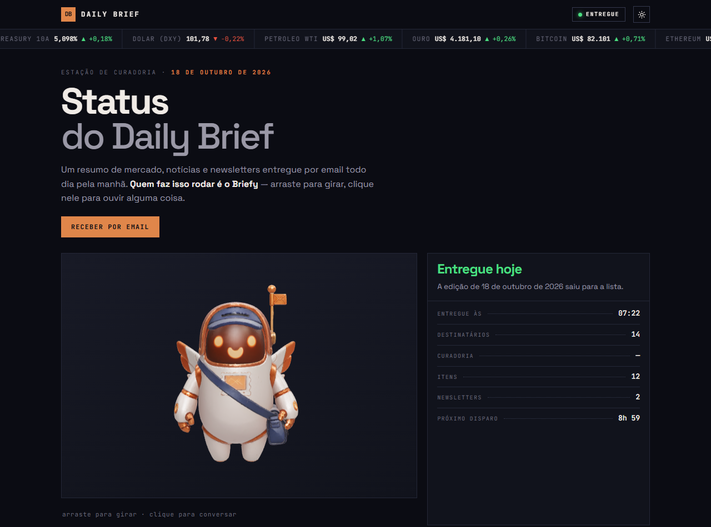
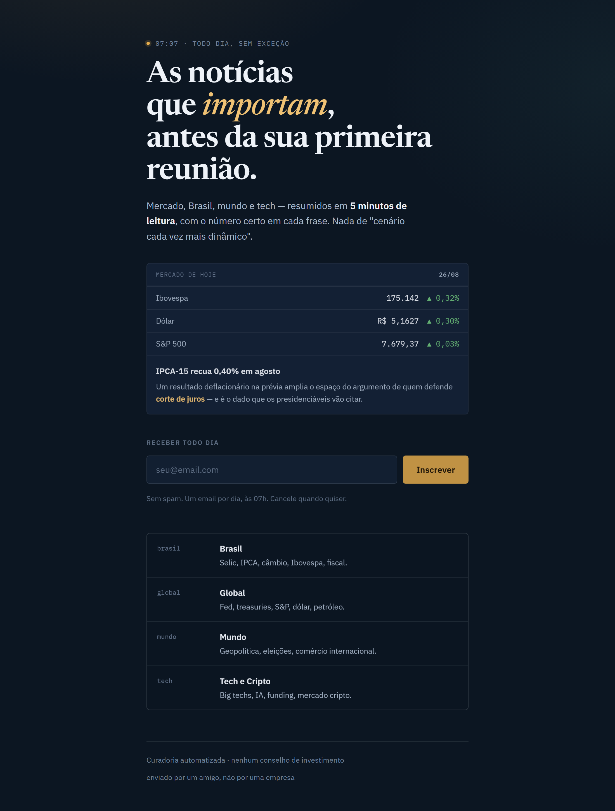
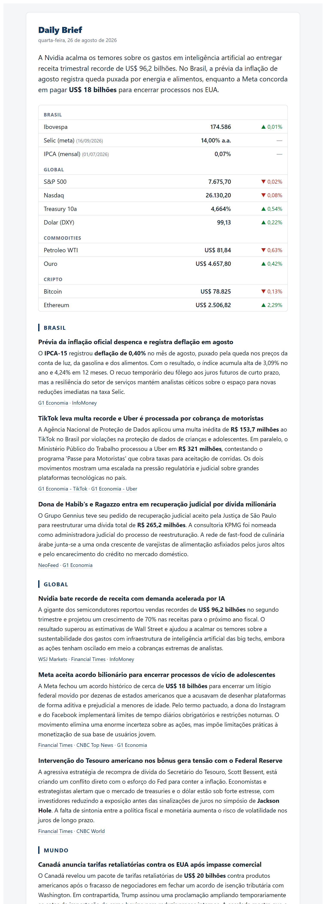

# Daily Brief

Resumo diário por email: mercado, notícias mundiais e as newsletters que você assina.
Sai às 07:20, em seções — números, Brasil, Global, Mundo, Tech e Cripto. Custo zero, sem servidor.

**[▶ Página de inscrição](https://felipe-parente-costa.github.io/daily-brief-showcase/)** ·
**[▶ Página de status, com o Briefy](https://felipe-parente-costa.github.io/daily-brief-showcase/status/)**

<a href="https://felipe-parente-costa.github.io/daily-brief-showcase/status/">

</a>
<p align="center"><em>A página de status. O Briefy é um modelo 3D de verdade — arraste para girar.</em></p>

<table>
<tr>
<td width="50%" valign="top">
<a href="https://felipe-parente-costa.github.io/daily-brief-showcase/">

</a>
<p align="center"><em>A página de inscrição</em></p>
</td>
<td width="50%" valign="top">
<a href="data/briefs/2026-08-26.html">

</a>
<p align="center"><em>O email — <a href="data/briefs/2026-08-26.html">edição real de 26/08</a></em></p>
</td>
</tr>
</table>

> **Este repositório é vitrine.** O código é o real e roda de verdade, mas a instância
> que envia o email todo dia mora num repositório privado: lá estão meu email, a planilha
> de inscritos e o histórico das minhas leituras. Aqui você encontra o mecanismo completo,
> o workflow, uma amostra real de saída (`data/`, 26/08/2026) e as duas páginas no ar,
> servidas pelo GitHub Pages a partir de `docs/`.
>
> **Quer sua própria instância?** Clone, siga *Rodar na nuvem* e cadastre seus secrets.
> Nada aqui depende de mim.

## Como funciona

```
cron-job.org ──► GitHub Actions ──► run_brief.py
  07:20            liga uma máquina       │
                   por ~2 minutos         ├─ 1. coleta      pipeline.py      16 feeds + 13 indicadores, janela de 30 h
                                          │                 newsletters.py   newsletters do Gmail via IMAP
                                          ├─ 2. curadoria   curator.py       a única etapa com IA
                                          ├─ 3. poda        run_brief.py     todo link tem que ter vindo da coleta
                                          ├─ 4. render      render.py        HTML + texto
                                          ├─ 5. envio       mailer.py        uma mensagem por leitor
                                          └─ 6. registro    pipeline.py      seen.json, entregas.json, caixa de enviados
                                                 │
                                                 └──► status.py ──► página de status (docs/status/)
```

**Quem aperta o botão.** Um serviço gratuito de cron externo (cron-job.org) chama o
`workflow_dispatch` às 07:20. O agendamento do próprio GitHub Actions é "melhor esforço"
e chegou a atrasar horas, então ficou como reserva: cinco horários entre 07:07 e 08:27.
Quem chega depois de a edição sair encerra em segundos, sem duplicar email.

**Buscar feed e cotação é trabalho de script**: mais barato, mais rápido, e quando quebra
você vê exatamente onde. O modelo entra só na triagem e na redação.

### Curadoria: uma cadeia, não um provedor

`curator.py` tenta em ordem e passa a vez quando um não responde:

1. **Gemini**: `gemini-3.7-flash` → `3.6-flash` → `3.5-flash`. Os três dividem a mesma
   capacidade e costumam cair juntos, por isso a cadeia não para aí.
2. **Qualquer API no dialeto `/chat/completions`** (Groq, OpenRouter, Cerebras, Mistral…),
   se `LLM_API_KEY`, `LLM_BASE_URL` e `LLM_MODELOS` estiverem cadastrados. Implementado só
   com a biblioteca padrão, sem SDK.
3. **Anthropic**, se `ANTHROPIC_API_KEY` estiver cadastrada (pago por uso).

**Privacidade:** no free tier, o Google usa o conteúdo enviado ao Gemini para treinar
modelos. Aqui isso é aceitável porque o material é notícia pública e newsletter; se não
for no seu caso, comece a cadeia pela Anthropic (`BRIEF_PROVIDER=anthropic`).

Cada chamada tem timeout. Os erros "tente de novo em N s" do provedor são respeitados, e
pedido recusado por tamanho é reenviado menor em vez de repetido igual.

**Se nenhum provedor responder**, entra o resgate: uma tarefa agendada no Claude Code
(08:01) confere se a edição saiu. Se não saiu, ela cura à mão seguindo `BRIEF.md`, sem
API, grava o JSON e dispara o workflow com `usar_brief=true`. Assim o envio usa
exatamente o mesmo caminho testado: render, uma mensagem por leitor, registro. A tarefa
só roda com o app do Claude Code aberto; fechado, ela executa quando o app abrir.

### Entrega

- **Inscritos**: o formulário da página de inscrição grava numa planilha do Google;
  `subscribers.py` lê o CSV público dela. Teto de 100 endereços, contra abuso do formulário.
- **Uma mensagem por destinatário**, nunca uma só com todos em cópia oculta.
- **Para não cair no spam**: `From` com nome, `Reply-To`, `List-Id`, `List-Unsubscribe` e
  um link visível de descadastro no rodapé.
- **Caixa de enviados**: cópias com mais de um dia vão para a lixeira via IMAP. A sua
  própria cópia, na caixa de entrada, fica.
- **Falha**: um email curto avisando, no máximo um por dia.

## A página de status e o Briefy

`status.py` agrega o que o projeto já produziu e monta `docs/status/`: situação do dia,
fita de cotações, calendário de edições, fontes e newsletters mais usadas, saúde de
cada fonte nas últimas 30 edições, mercado do dia e o arquivo de todas as edições,
em pastas por mês.

Duas garantias, porque isso vai para um repositório público:

- As edições do arquivo são **re-renderizadas** do JSON, sem o link de descadastro
  (que carrega o endereço de quem recebeu).
- Antes de publicar, `status.py` varre tudo o que gerou atrás de email, `mailto:`, id da
  planilha e o alias de newsletters, e **aborta** se achar algum.

O workflow publica a página logo depois do envio, com `if: always()`: num dia de falha,
a página precisa dizer que falhou. Sem o secret `SHOWCASE_TOKEN`, o passo sai em
silêncio; a página nunca derruba o email.

**O Briefy** (`site/briefy.js`, `site/modelos/briefy.glb`) é um GLB de 3,9 MB com
50 mil triângulos e dois morph targets nas asas. A cor de destaque da página saiu da
textura dele (k-means), e ele tem dois modos:

- **entregando ou entregue**: flutua e bate as asas;
- **falhou**: as asas caem, o corpo afunda, inclina e escurece.

O modelo veio de uma geração no ChatGPT, com 500 mil triângulos e 50 MB. Reduzir a malha
normalmente apaga a animação, porque morph target é deslocamento por vértice; aqui o
deslocamento de cada vértice novo veio dos 4 vizinhos mais próximos na malha original.
O máximo passou de 0,0909 para 0,0907. A câmera só gira ±45° pela frente: de trás, a asa
colada nas costas deforma como borracha.

## Rodar na mão

```bash
cd "/caminho/do/seu/projeto" && python pipeline.py --check
```

Testa as 29 fontes e imprime o status de cada uma. Rode isto primeiro sempre que
algo parecer errado, e sempre depois de adicionar fonte nova.

```bash
cd "/caminho/do/seu/projeto" && python pipeline.py
```

Coleta o dia e grava em `data/raw/`.

```bash
cd "/caminho/do/seu/projeto" && python render.py data/briefs/2026-08-26.json
```

Gera o `.html` e o `.txt` do email a partir de um brief já curado.

```bash
cd "/caminho/do/seu/projeto" && python status.py --saida site_build
```

Monta a página de status localmente; abra `site_build/index.html` por um servidor
(`python -m http.server --directory site_build`).

## Rodar na nuvem

`run_brief.py` faz o ciclo inteiro e `.github/workflows/daily-brief.yml` o dispara. O
repositório da instância **precisa ser privado**: o histórico em `data/` traz o seu email.

Secrets em *Settings → Secrets and variables → Actions*:

| Secret | O que é |
|---|---|
| `GEMINI_API_KEY` | chave em aistudio.google.com — grátis, sem cartão |
| `GMAIL_USER` | a conta que lê as newsletters e envia o brief |
| `GMAIL_APP_PASSWORD` | senha de app do Google, 16 caracteres, **não** a senha da conta |
| `BRIEF_TO` | opcional; destinatário, se for diferente de `GMAIL_USER` |
| `BRIEF_SUBSCRIBERS_SHEET_ID` | opcional; id da planilha de inscritos (leitura pública) |
| `LLM_API_KEY`, `LLM_BASE_URL`, `LLM_MODELOS` | opcional; reserva no dialeto da OpenAI |
| `ANTHROPIC_API_KEY` | opcional; último degrau da cadeia, pago por uso |
| `SHOWCASE_TOKEN` | opcional; token fino com `Contents: Read and write` só no repositório da página |

A senha de app sai de `myaccount.google.com/apppasswords` e exige verificação em
duas etapas ligada. É ela que abre o IMAP (ler newsletters) e o SMTP (enviar).

**Disparo manual** (*Actions → Daily Brief → Run workflow*), com opções:

| Opção | Para quê |
|---|---|
| `force` | reenviar mesmo se a edição de hoje já saiu |
| `so_dono` | teste: envia só para você, sem tocar na planilha nem no `seen.json` |
| `amigos_teste` | teste: endereços extras, separados por vírgula |
| `provedor` | força um provedor da cadeia, para provar que a reserva funciona |
| `usar_brief` | rota manual: usa o JSON já commitado, sem chamar API (ver `BRIEF.md`) |
| `diagnostico` | só mede os limites por modelo do provedor reserva (`probe_llm.py`) |

**Custo total: zero.** O plano Free do GitHub dá 2.000 minutos por mês em repositório
privado, e este job fica muito abaixo disso: a execução que envia leva de 1 a 2 minutos, e
as de reserva encerram em segundos. O cron-job.org é gratuito, e a curadoria no Gemini
Flash está no free tier.

O passo final do workflow commita `data/` de volta. Sem isso o `seen.json` volta ao
estado do repositório e o brief de amanhã repete as manchetes de hoje.

### O que a rota autônoma faz de diferente

Sem humano no loop não existe "corrija antes de renderizar". `run_brief.py` poda o
brief antes de validar: link que não saiu da coleta do dia é removido, item que fica
sem link nenhum é descartado, e destaque acima do teto é desmarcado. Se depois disso
o `--validar` ainda reprovar, nada é enviado e chega um email curto avisando da falha.
Newsletter é bônus: se o IMAP não responder, a edição sai sem a seção.

## Configuração das newsletters

O agente lê as newsletters do **seu Gmail**, não do LinkedIn. Raspar o LinkedIn viola
os Termos de Uso e arrisca sua conta; entrega por email dá o mesmo conteúdo sem risco.

**Assine tudo usando o alias `seuemail+brief@gmail.com`.** O Gmail entrega
qualquer coisa endereçada a `seuendereco+qualquercoisa@gmail.com` na sua caixa normal,
e o agente acha essas mensagens com uma busca `to:`. Assim **não é preciso criar filtro
nem marcador nenhum** — o alias já é a etiqueta.

Se algum site recusar o `+` no campo de email (acontece), assine com o endereço normal
e crie um filtro para aquele remetente com o marcador `Brief/Fontes`: o agente procura
pelas duas rotas e junta o resultado.

**No LinkedIn**: não há rota. Procuramos em 26/08/2026 e a opção de entrega por email
por newsletter não existe mais na interface — o menu "⋯" da newsletter só oferece
compartilhar e denunciar, e *Configurações → Notificações → Notícias e relatórios* trata
do conteúdo editorial do próprio LinkedIn, não das newsletters que você assina. As que
só existem lá dentro ficam de fora do brief até o LinkedIn devolver a opção. O agente
ainda procura por `newsletters-noreply@linkedin.com`, caso volte.

Enquanto nada chegar, o brief sai normalmente — só sem a seção de newsletters.

## Newsletters sugeridas

Assine com o alias `+brief`. Comece por 8–10, não por 25: newsletter demais entope a
seção e o teto de itens por seção continua valendo — o excesso é descartado, não lido.
Prefira 2 ou 3 diárias e o resto semanal.

**Gestoras e bancos**

| Fonte | O que é | Cadência | Link |
|---|---|---|---|
| Apollo — The Daily Spark | Torsten Sløk, gráfico + parágrafo por dia. Denso e sem enrolação. | diária | [assinar](https://www.apolloacademy.com/daily-spark/subscription/) |
| Goldman Sachs — Briefings | Mercados, setores e economia global. | semanal (sexta) | [assinar](https://www.goldmansachs.com/briefings) |
| J.P. Morgan — Eye on the Market | Michael Cembalest. Longo, opinativo, bem argumentado. | periódica | [página](https://am.jpmorgan.com/us/en/asset-management/institutional/insights/market-insights/eye-on-the-market/) |
| Oaktree — memos do Howard Marks | Raro e denso. Ciclo de crédito e risco. | esporádica | [página](https://www.oaktreecapital.com/insights/memos) |
| KKR — Insights / Global Macro Trends | Henry McVey, alocação e macro. | periódica | [página](https://www.kkr.com/insights) |
| BlackRock Investment Institute | Comentário semanal de mercado. | semanal | confirmar na página |
| PIMCO — Economic and Market Commentary | Renda fixa e juros. | periódica | confirmar na página |
| Morgan Stanley — Thoughts on the Market | Episódio curto diário, com transcrição. | diária | confirmar na página |

Verifiquei os dois primeiros links direto na página de assinatura. Os demais têm página
pública confirmada, mas o caminho exato do cadastro de email pode ter mudado.

**Consultorias**: McKinsey Insights, BCG Perspectives, Bain Insights, Deloitte Insights.
Cadência semanal ou quinzenal, bom para tese setorial — fraco para o dia a dia.

**Brasil**: The Brief (Exame), XP Expert, Itaú Macro Visão.
Brazil Journal, NeoFeed e Turim (View of the Week) **não precisam de assinatura** — entram por RSS.
O feed do Turim fica em `/publicacoes/insights/feed/`; a raiz do site devolve feed vazio.

**Tech e IA**: Stratechery (pago, mas o melhor do gênero), a16z, Import AI, Ben's Bites.

## Adicionar ou trocar fontes

Edite `config/sources.json`:

- **Feed novo** — acrescente em `feeds` com `id`, `nome`, `secao` (`brasil`, `global`,
  `mundo` ou `tech`), `url` e `max_itens`. Rode `python pipeline.py --check` para
  confirmar que responde e traz itens.
- **Indicador novo** — em `mercado`, sob o provedor certo. Yahoo aceita qualquer
  ticker (`PETR4.SA`, `^FTSE`, `EURUSD=X`); BCB aceita qualquer série do SGS.
- **Recorte editorial** — `config/profile.md` controla tom, temas e o que descartar.
  É o arquivo para mexer quando o email vier bom demais para um lado ou chato demais.

## Estrutura

```
config/sources.json   feeds, tickers e séries
config/profile.md     perfil editorial: tom, temas, o que descartar
collectors/feeds.py   RSS/Atom via xml.etree, com retry e tolerância a BOM
collectors/markets.py Yahoo (índices, câmbio, commodities), CoinGecko, BCB
pipeline.py           orquestra a coleta (--check, --validar, --marcar)
newsletters.py        as três rotas de busca de newsletter, via IMAP
curator.py            curadoria por API, com a cadeia de provedores
run_brief.py          ciclo completo sem humano: coleta → curadoria → poda → envio → registro
render.py             brief JSON → HTML e TXT do email
mailer.py             SMTP, cabeçalhos de entregabilidade, limpeza da caixa de enviados
subscribers.py        lista de inscritos a partir da planilha
status.py             monta a página de status e varre a saída atrás de dado pessoal
probe_llm.py          mede os limites reais por modelo do provedor reserva
BRIEF.md              rota manual de emergência: curadoria à mão, sem API
site/                 código da página de status (o Briefy está em site/briefy.js)
docs/                 o que o GitHub Pages serve: inscrição (index.html) e status/
data/raw/             coleta bruta por dia
data/briefs/          brief curado + HTML + TXT por dia
data/seen.json        links dos últimos 7 dias, para não repetir manchete
data/entregas.json    quantos receberam, a que hora e quem curou (só contagem)
.github/workflows/    o workflow do GitHub Actions
```

## Detalhes que custaram tempo (não desfaça sem ler)

- **Câmbio fora da AwesomeAPI**: ela respondia 429 em *todas* as coletas feitas pelo
  GitHub Actions — o limite é por IP, e os IPs compartilhados dos runners vivem
  estourados. Da máquina local funcionava, o que escondeu o problema por 54 edições.
  Dólar e euro vêm do Yahoo (`USDBRL=X`, `EURBRL=X`), o mesmo caminho dos índices.
- **Timeout em tudo**: `imaplib`, `smtplib` e o SDK do Gemini esperam para sempre por
  padrão. Uma execução já ficou 30 minutos pendurada sem uma linha de log. Hoje toda
  conexão tem timeout, e a saída é escrita linha a linha (`line_buffering`) para o log
  sobreviver mesmo se o job for morto.
- **Fechamento anterior do Yahoo**: `previousClose` vem nulo e `chartPreviousClose`
  é o fechamento anterior à *janela* pedida (5 dias atrás), não à véspera. A variação
  correta sai do penúltimo fechamento da série. Ver `collectors/markets.py`.
- **Gzip não declarado**: o servidor do G1 devolve gzip de forma intermitente, mesmo
  sem `Accept-Encoding` no pedido e sem declarar no cabeçalho. A coleta sniffa os
  bytes mágicos antes de parsear — sem isso a fonte falha em dias aleatórios.
- **CoinGecko em lote**: a API gratuita responde 429 com poucas chamadas por minuto.
  As duas moedas vêm numa requisição só; não separe.
- **BOM UTF-8**: o feed do Federal Reserve começa com BOM. É removido antes do parse.
- **`--validar`**: confere se todo link do brief saiu mesmo da coleta do dia. Link
  trocado entre itens não aparece na leitura — só quando alguém clica.
- **WSJ mudou de host**: `feeds.a.dj.com` responde 200 mas está congelado em jan/2025.
  O host vivo é `feeds.content.dowjones.io` — o mesmo do MarketWatch.
- **FT, WSJ e Economist são pagos**: o RSS entrega título e resumo, que bastam para o
  brief, mas o link pode bater em paywall. É esperado, não é defeito.
- **IMAP `BEFORE` exclui o dia citado**: a limpeza da caixa de enviados usa
  `hoje - (dias - 1)`, senão as cópias de ontem escapam.
